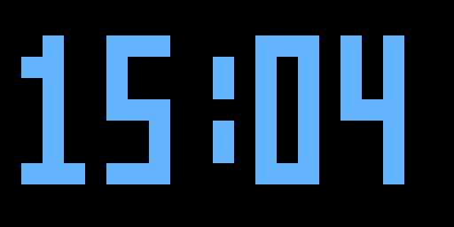
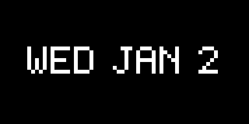
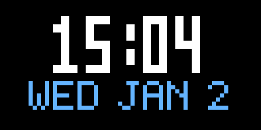
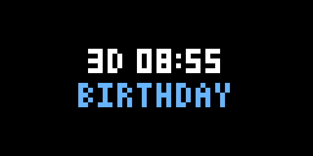
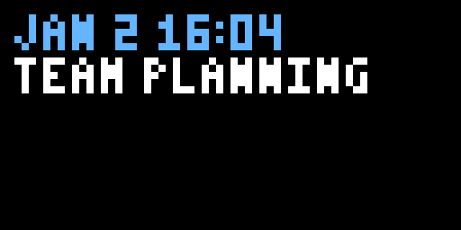
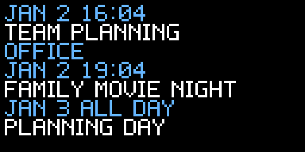

# UDB Temporal

Time and calendar boards for [UDB](https://github.com/benwiebe/udb-core), a plugin-based runtime for Raspberry Pi LED matrix displays. Boards render with bitmap pixel fonts and can be previewed through UDB's HTTP display without hardware.

Requires Go 1.26.1 or later and `udb-plugin-library v0.7.0` or later. Plugins are normal Go packages compiled into UDB; there are no runtime `.so` files.

## Boards and datasources

| Board ID | Purpose | Datasource ID |
|----------|---------|---------------|
| `digital-clock` | Clock with configurable format, timezone and blinking colon | `current-time` |
| `date` | Current date | `current-time` |
| `clock-date` | Stacked clock and date | `current-time` |
| `countdown` | Time remaining until a target, with an optional label | `current-time` |
| `upcoming-events` | Next calendar event or a short list | `ical-calendar-events` or `caldav-calendar-events` |

Every configuration references the plugin ID `udb-plugin-temporal`. You must declare datasource instances; UDB does not create them automatically. Explicitly select the datasource on each board when using multiple calendars.

## Try the plugin locally

With sibling checkouts of UDB core, the plugin library and this plugin:

1. Add `import _ "github.com/benwiebe/udb-plugin-temporal"` to core's `plugin_imports.go`.
2. From the core directory, ensure the modules are in your Go workspace: `go work use . ../udb-plugin-library ../udb-plugin-temporal`.
3. Build core with `make build`.
4. From this plugin directory, copy `examples/config.json` to `config.json` and run `../udb-core/udb`.
5. Open <http://localhost:8080> to see all five boards rotate.

The demo reads [a local recurring calendar](examples/demo.ics). The countdown target is an example; change it to your own date. UDB reads `config.json` from the working directory, and the example calendar path is relative to that directory.

Full configurations are provided for [all boards with a local calendar](examples/config.json), [an HTTP/webcal feed](examples/ical-http.json), and [CalDAV with an event list](examples/caldav.json). Replace the remote examples' URLs and credentials before use. Set positive `durationSeconds` values to rotate dynamic boards; an omitted or zero duration holds one board indefinitely.

See [the configuration reference](docs/CONFIGURATION.md) for every setting and default, plus calendar behavior and supported recurrence features.

## Rendered examples

These PNGs come directly from board rendering, enlarged with nearest-neighbor scaling. Clock, date, countdown and next-event examples use 64×32 pixels; the calendar list uses 128×64.

| Digital clock | Date |
|---------------|------|
|  |  |

| Clock and date | Countdown |
|----------------|-----------|
|  |  |

| Next event | Event list |
|------------|------------|
|  |  |

## Development

```sh
make check       # build, tests and vet
make race        # race detector
make screenshots # regenerate README images
```

To verify published dependencies instead of sibling workspace modules, run `GOWORK=off make check` and `GOWORK=off make race`. CI uses this standalone mode.

## v1.0.0 scope

Implemented: the five boards above, a shared calendar event contract, polling with immediate change notifications, ICS and CalDAV backends, outage recovery, config examples, rendered screenshots, and automated checks.

Before tagging v1.0.0, complete a real-server CalDAV smoke test and a physical Raspberry Pi display check. Automated CalDAV tests cover authentication, discovery, calendar selection, bounded REPORT requests and response conversion; they do not establish compatibility with every provider.

World clocks, timers, stopwatches, sunrise/sunset, additional themes and broad locale support are deferred. See the configuration reference for calendar-format limitations.

## License

GPL-3.0; see [LICENSE](LICENSE).
