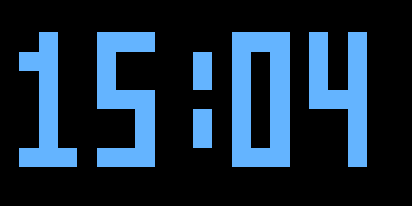
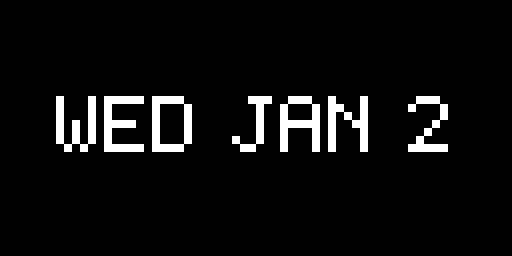
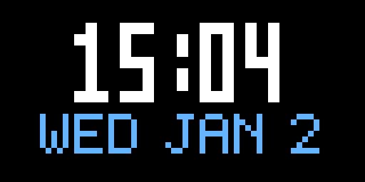
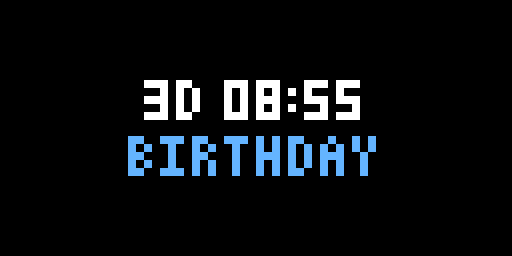
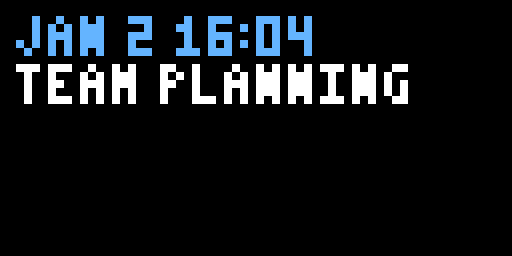
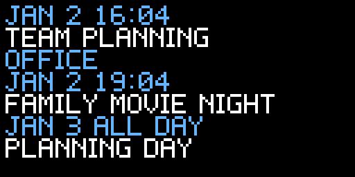

# UDB Temporal

Time, date, countdown, and calendar boards and datasources for [UDB (Universal Display Board)](https://github.com/benwiebe/udb-core), a modular runtime for Raspberry Pi LED matrix displays.

Boards render with crisp bitmap pixel fonts and optional bold text faces, supporting both hardware LED panels and UDB's built-in HTTP virtual display preview.

## Features

- **Digital Clock**: Configurable 12/24-hour time layouts, timezone selection, blinking colons, custom colours, and pixel font styles.
- **Date Display**: Formatted dates with optional uppercase rendering, custom colours, and midnight rollover transitions.
- **Stacked Clock & Date**: Compact two-line display with independent font sizing, per-line colours, and custom line gaps.
- **Countdown Timer**: Target date countdown with auto-wrapping labels, optional seconds, customizable expiration text, and sub-second expiry updates.
- **Upcoming Events**: Calendar display with single-event or multi-line list layouts, relative date tags ("Today", "Tomorrow"), all-day event support, and outage resilience.
- **Flexible Calendar Providers**: iCalendar (.ics files or HTTP/webcal URLs with ETag/Last-Modified caching) and CalDAV with auto-discovery and server-side recurrence expansion.

## Boards and Datasources

| Board ID | Purpose | Compatible Datasources |
|---|---|---|
| `digital-clock` | Clock with configurable layout, timezone, and colon blinking | `current-time` |
| `date` | Current date display | `current-time` |
| `clock-date` | Stacked two-line clock and date | `current-time` |
| `countdown` | Time remaining until target timestamp with optional label | `current-time` |
| `upcoming-events` | Next calendar event or multi-event list | `ical-calendar-events`, `caldav-calendar-events` |

| Datasource ID | Type | Description |
|---|---|---|
| `current-time` | Instantaneous | Provides system/local timestamps synchronously on render. |
| `ical-calendar-events` | Polling / Cache | Fetches local `.ics` files or remote HTTP(S)/webcal iCalendar feeds. |
| `caldav-calendar-events` | Polling / Cache | Connects to remote CalDAV servers with calendar discovery and expansion. |

## Using with UDB

UDB plugins are compiled directly into the binary. Every temporal board and datasource references the plugin identifier `udb-plugin-temporal`.

### 1. Include the Plugin in UDB

Add a blank import to `plugin_imports.go` in your UDB build:

```go
import _ "github.com/benwiebe/udb-plugin-temporal"
```

Or build UDB using the `PLUGINS` build argument:

```sh
make build PLUGINS="github.com/benwiebe/udb-plugin-temporal@v1.0.0"
```

### 2. Configure Datasources and Boards

Declare datasource instances in the `datasources` section of your UDB `config.json`, then reference them in your `boards` entries:

```json
{
  "display": { "type": "http", "width": 64, "height": 32, "scale": 8 },
  "datasources": [
    {
      "id": "clock",
      "plugin": "udb-plugin-temporal",
      "datasourceId": "current-time"
    },
    {
      "id": "calendar",
      "plugin": "udb-plugin-temporal",
      "datasourceId": "ical-calendar-events",
      "config": {
        "url": "https://example.com/calendar.ics",
        "timezone": "America/Toronto",
        "refreshSeconds": 300,
        "maxEvents": 10
      }
    }
  ],
  "boards": [
    {
      "plugin": "udb-plugin-temporal",
      "boardId": "digital-clock",
      "datasource": "clock",
      "durationSeconds": 8,
      "config": { "timezone": "America/Toronto", "colour": "#64B4FF" }
    },
    {
      "plugin": "udb-plugin-temporal",
      "boardId": "upcoming-events",
      "datasource": "calendar",
      "durationSeconds": 8,
      "config": { "timezone": "America/Toronto", "padding": 2 }
    }
  ]
}
```

For complete configuration options, default values, and recurrence details, see the [Configuration Reference](docs/CONFIGURATION.md).

## Quickstart / Local Demo

To preview the plugin locally without LED hardware:

1. Clone `udb-core`, `udb-plugin-library`, and `udb-plugin-temporal` side by side.
2. In `udb-core`, initialize the workspace: `go work init . ../udb-plugin-library ../udb-plugin-temporal`.
3. In `udb-core/plugin_imports.go`, ensure `import _ "github.com/benwiebe/udb-plugin-temporal"` is present.
4. Build UDB: `cd ../udb-core && make build`.
5. Run UDB from `udb-plugin-temporal`:
   ```sh
   cd ../udb-plugin-temporal
   ../udb-core/udb -config examples/config.json
   ```
6. Open <http://localhost:8080> in your browser to view the rotating demo boards.

Example configurations are available in `examples/`:
- [`examples/config.json`](examples/config.json): All 5 boards rotating with a local sample `.ics` file.
- [`examples/ical-http.json`](examples/ical-http.json): Remote iCalendar / webcal HTTP feed.
- [`examples/caldav.json`](examples/caldav.json): CalDAV integration with an event list on a 128×64 display.

## Rendered Examples

Scaled pixel-accurate renderings generated from the plugin's actual rendering pipeline:

| Digital Clock | Date |
|---|---|
|  |  |

| Clock and Date | Countdown |
|---|---|
|  |  |

| Next Event (64×32) | Event List (128×64) |
|---|---|
|  |  |

## Development & Contributing

We welcome contributions! Please see [CONTRIBUTING.md](docs/CONTRIBUTING.md) for architecture details, testing guidelines, and submission instructions.

### Common Development Commands

```sh
make check       # Run build, unit tests, and go vet
make race        # Run tests with Go race detector
make tidy        # Clean up and verify go.mod
make screenshots # Regenerate preview screenshots in docs/screenshots/
```

To run checks against published modules rather than local workspace directories:

```sh
GOWORK=off make check
GOWORK=off make race
```

## License

GPL-3.0; see [LICENSE](LICENSE).
